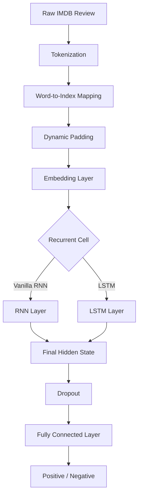

# IMDB Sentiment Analysis with RNN and LSTM


---

## 🎬 Overview

A movie review can contain more than a collection of words. Its meaning often depends on context, word order, and relationships between different parts of a sentence.

Understanding whether a review expresses a positive or negative opinion is therefore a natural application of **Natural Language Processing (NLP)** and sequence modeling.

In this project, we build a deep learning pipeline for binary sentiment classification using the **IMDB Movie Reviews Dataset**.

Two recurrent neural network architectures are implemented and compared:

- **Vanilla RNN:** A fundamental recurrent architecture that processes sequential information through hidden states.
- **LSTM:** A more advanced recurrent architecture designed to capture long-term dependencies using its memory cell and gating mechanisms.

Both models share the same data-processing pipeline, embedding configuration, training procedure, and evaluation workflow, allowing their performance to be compared under consistent experimental conditions.

## 🎯 Project Objectives

The main objectives are:

- Build a complete text-classification pipeline using PyTorch.
- Convert raw movie reviews into numerical token sequences.
- Implement vocabulary-based tokenization and word embeddings.
- Handle variable-length sequences using dynamic padding.
- Apply packed sequences to avoid unnecessary recurrent computation over padding tokens.
- Implement Vanilla RNN and LSTM architectures.
- Train both models using a shared training framework.
- Compare their classification performance using loss and accuracy.

## 🧠 Model Architectures

### 1. Vanilla RNN

A Vanilla Recurrent Neural Network processes a sequence one token at a time, updating its hidden state at every step.

[
h_t = \tanh(W\_{xh}x_t + W\_{hh}h\_{t-1} + b_h)
]

The final hidden state is used as a representation of the entire review and passed to a classification layer.

While simple and computationally straightforward, Vanilla RNNs can struggle to preserve information across long sequences due to vanishing gradients.

### 2. Long Short-Term Memory (LSTM)

LSTM extends the recurrent architecture with a memory cell and gating mechanisms.

Its gates control how information is stored, forgotten, and exposed:

- Forget Gate
- Input Gate
- Cell State
- Output Gate

This design helps the network preserve relevant information over longer sequences and makes LSTM particularly useful for text-processing tasks.

### Architecture Comparison

| Characteristic           | Vanilla RNN                             | LSTM                        |
| ------------------------ | --------------------------------------- | --------------------------- |
| Recurrent mechanism      | Simple hidden state                     | Hidden state and cell state |
| Memory control           | No explicit gates                       | Gated memory                |
| Long-term dependencies   | More difficult                          | Better supported            |
| Computational complexity | Lower                                   | Higher                      |
| Gradient stability       | More susceptible to vanishing gradients | Improved through gating     |

## 🏗️ Model Architecture

Both models follow the same high-level pipeline:



### Model Configuration

The default experimental configuration is:

| Parameter                  |         Value |
| -------------------------- | ------------: |
| Vocabulary size            |  Up to 30,000 |
| Embedding dimension        |           128 |
| Hidden dimension           |           256 |
| Number of recurrent layers |             1 |
| Dropout                    |           0.5 |
| Number of output classes   |             2 |
| Batch size                 |            64 |
| Training epochs            |            10 |
| Optimizer                  |          Adam |
| Learning rate              |         0.001 |
| Loss function              | Cross Entropy |
| Maximum gradient norm      |           5.0 |

The vocabulary reserves two special tokens:

- `<pad>`: Padding token, index 0.
- `<unk>`: Unknown token, index 1.

## 📚 Data Processing Pipeline

The project uses the IMDB movie reviews dataset, containing positive and negative reviews organized into training and testing splits.

### Tokenization

Reviews are converted into lowercase token sequences. Basic punctuation marks are separated from neighboring words before splitting the text into tokens.

### Vocabulary Mapping

Each token is mapped to a numerical index using a predefined IMDB vocabulary file.

Words not present in the vocabulary are mapped to the unknown token.

### Dynamic Padding

Reviews have different lengths, so sequences within each batch are padded to the length of the longest review in that batch.

This avoids padding every review to one global maximum length.

### Packed Sequences

The project uses PyTorch's `pack_padded_sequence` to process variable-length sequences efficiently.

Instead of performing recurrent computation over padded positions, the packed representation allows the RNN or LSTM to operate on the actual sequence lengths.

The batches are also sorted by descending sequence length during collation.

**Relevant implementation:** `data.py`

## ⚙️ Training Pipeline

A shared `Trainer` class handles the training and evaluation loops for both architectures.

The training workflow includes:

1. Forward propagation through the embedding and recurrent layers.
2. Computing classification loss using Cross Entropy.
3. Backpropagation.
4. Gradient clipping to limit exploding gradients.
5. Updating model parameters using Adam.
6. Tracking loss and accuracy across epochs.

### Gradient Clipping

Recurrent networks can experience exploding gradients during backpropagation through time.

To help control this issue, the project applies gradient norm clipping:

[
g \leftarrow g \cdot
\min\left(1,\frac{5.0}{|g|}\right)
]

This constrains the gradient norm to a maximum value of 5.0.

### Training Metrics

The training framework tracks:

- Training Loss
- Training Accuracy
- Evaluation Loss
- Evaluation Accuracy
- Best recorded evaluation accuracy

These metrics make it possible to observe learning progress and compare the two architectures.

## 📊 Experimental Comparison

The main experiment trains both architectures using the same dataset and training configuration.

| Model       | Embedding Size | Hidden Size | Epochs |
| ----------- | -------------: | ----------: | -----: |
| Vanilla RNN |            128 |         256 |     10 |
| LSTM        |            128 |         256 |     10 |

The final comparison reports the best recorded accuracy for each model.

**Results:** Numerical results and training plots can be added here after running the experiment.

> **Evaluation note:** In the current implementation, `test_loader` is evaluated after every training epoch, and the best accuracy is tracked using those results. Therefore, `best_val_acc` is technically the best test accuracy, not validation accuracy. For a rigorous final comparison, a separate validation split should be used for model selection, with the test set evaluated only once at the end.

## 🛠️ Technologies

| Technology              | Purpose                                    |
| ----------------------- | ------------------------------------------ |
| Python                  | Core implementation                        |
| PyTorch                 | Neural network implementation and training |
| NumPy / PyTorch Tensors | Numerical computation                      |
| tqdm                    | Training progress visualization            |
| IMDB Dataset            | Sentiment classification data              |

## 📁 Project Structure

```text
imdb-sentiment-analysis-rnn-lstm/
│
├── data.py
├── model.py
├── trainer.py
├── main.py
│
└── aclImdb/
    ├── imdb.vocab
    ├── train/
    │   ├── pos/
    │   └── neg/
    └── test/
        ├── pos/
        └── neg/
```

## 🚀 Getting Started

### Prerequisites

- Python
- pip
- PyTorch
- IMDB dataset in the expected directory structure

### 1. Clone the Repository

```bash
git clone https://github.com/VahhabBM/imdb-sentiment-analysis-rnn-lstm.git
cd imdb-sentiment-analysis-rnn-lstm
```

### 2. Create a Virtual Environment

```bash
python -m venv .venv
```

Activate it:

**Windows:**

```bash
.venv\Scripts\activate
```

**Linux / macOS:**

```bash
source .venv/bin/activate
```

### 3. Install Dependencies

```bash
pip install torch tqdm
```

For GPU acceleration, install the appropriate CUDA-enabled PyTorch build using the official installation selector:

[https://pytorch.org/get-started/locally/](https://pytorch.org/get-started/locally/)

### 4. Prepare the Dataset

Download and extract the IMDB dataset.

The project expects the following files and directories:

```text
aclImdb/
├── imdb.vocab
├── train/
│   ├── pos/
│   └── neg/
└── test/
    ├── pos/
    └── neg/
```

Place the `aclImdb` directory in the project root.

### 5. Run the Experiment

```bash
python main.py
```

The script automatically selects CUDA when available, loads the dataset, trains the Vanilla RNN and LSTM models, and prints their best recorded accuracy.

## 🔍 Implementation Highlights

- Custom PyTorch `Dataset` implementation for IMDB reviews.
- Vocabulary-based text-to-index conversion.
- Dynamic batch padding with `pad_sequence`.
- Sequence-length-aware batching.
- Packed sequences using `pack_padded_sequence`.
- Configurable recurrent cell selection.
- Shared training framework for both architectures.
- Gradient clipping for training stability.
- Automatic CPU/GPU device selection.

## 👨‍💻 Authors

**Vahhab Balandomanesh**

**Mohammadmehdi Kazemi**

---

## 📖 References

- [PyTorch Documentation](https://pytorch.org/docs/stable/index.html)
- [IMDB Movie Reviews Dataset](https://ai.stanford.edu/~amaas/data/sentiment/)
- [Long Short-Term Memory](https://www.bioinf.jku.at/publications/older/2604.pdf)
- [Recurrent Neural Networks](https://en.wikipedia.org/wiki/Recurrent_neural_network)

---

\<p align="center">
&#x20; \<strong>Every review tells a story. The challenge is teaching a machine to understand its sentiment.\</strong>
\</p>
